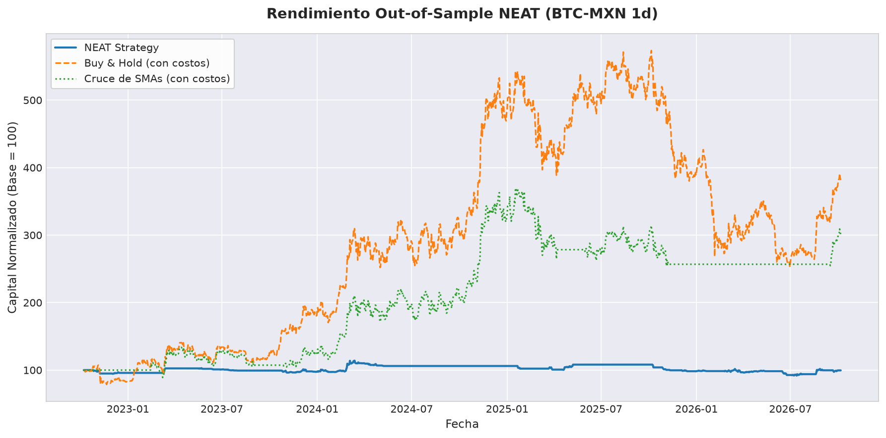
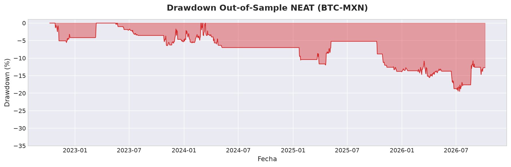

<div align="center">

# 🧠 NEAT Algorithmic Trading System
### Optimización de Estrategias Financieras mediante Neuroevolución Multiobjetivo y Control de Riesgo Co-Evolutivo

[](https://www.python.org/)
[](tests/)
[](#arquitectura-del-sistema)
[](#evaluación-walk-forward)
[](#módulo-de-paper-trading-en-vivo)
[](LICENSE)

*Un framework de trading cuantitativo de alto rendimiento que combina algoritmos genéticos (NEAT), selección automática de indicadores técnicos, co-evolución de parámetros de riesgo e inferencia en tiempo real con auditoría de fricción.*

---

</div>

## 📌 Resumen

El diseño tradicional de estrategias cuantitativas adolece de **sobreajuste (overfitting)** por fijar arquitecturas de red arbitrarias, optimizar parámetros de manera aislada y carecer de control estricto sobre la fuga temporal (*data leakage*).

Este proyecto implementa desde cero un sistema integral de **Neuroevolución de Topologías Aumentadas (NEAT)** adaptado específicamente a series de tiempo financieras en criptomonedas (**BTC-MXN**). A diferencia de los enfoques convencionales de Deep Learning con topologías estáticas, este sistema:

1. **Inicia desde topologías mínimas** (sin nodos ocultos) y complejiza progresivamente la estructura neuronal solo cuando demuestra ventaja adaptativa medible.
2. **Co-evoluciona la gestión del riesgo** dentro del propio genoma (*Stop Loss*, *Take Profit*, *Trailing Stop*, *Position Sizing* y cortacircuito por *Max Drawdown*).
3. **Aplica selección dinámica de variables** mediante una máscara de indicadores evolucionable (activando solo los inputs predictivos y apagando el ruido).
4. **Valida con análisis Walk-Forward estricto** en ventanas rodantes plurianuales de *Train*, *Validation* y *Test Out-of-Sample* (OOS).
5. **Audita la microestructura de mercado en vivo** mediante un motor de *Paper Trading* conectado a la API REST de **Bitso**, registrando ejecuciones a precios reales del *Order Book* (*Best Ask* en compras, *Best Bid* en ventas).

---

## 🏛️ Arquitectura del Sistema

```
                      ┌────────────────────────────────────────┐
                      │        DATOS CRUDOS OHLCV (1d)         │
                      │        Bitso REST / Yahoo Finance      │
                      └───────────────────┬────────────────────┘
                                          │
                                          ▼
                      ┌────────────────────────────────────────┐
                      │       PIPELINE & INDICADORES           │
                      │  18 Indicadores (Trend, Mom, Vol, Vol) │
                      │   Normalización Z-Score Rolling (252)  │
                      │  Compresión Tanh (Cero Data Leakage)   │
                      └───────────────────┬────────────────────┘
                                          │
                                          ▼
                      ┌────────────────────────────────────────┐
                      │         MOTOR NEAT CO-EVOLUTIVO        │
                      │  • Topología de Red (Conexiones/Nodos) │
                      │  • Máscara de Selección de Indicadores │
                      │  • Parámetros de Trading y Riesgo      │
                      │  • Especiación & Fitness Multiobjetivo │
                      └───────────────────┬────────────────────┘
                                          │
                 ┌────────────────────────┴────────────────────────┐
                 ▼                                                 ▼
┌─────────────────────────────────┐               ┌─────────────────────────────────┐
│     VALIDACIÓN WALK-FORWARD     │               │      PAPER TRADER EN VIVO       │
│  • Ventanas Train / Val / Test  │               │  • Ingesta 260 velas cerradas   │
│  • Criterio Min(Train, Val)     │               │  • Inferencia Diaria (Cerebro)  │
│  • Penalización por Turnover    │               │  • Auditoría Order Book en vivo │
│  • Curvas OOS & Benchmarks      │               │  • Registro real live_trades.csv│
└─────────────────────────────────┘               └─────────────────────────────────┘
```

---

## 🔬 Componentes Técnicos Clave

### 1. Ingesta y Normalización Causal (`src/data/`)
- **Normalización Rolling sin Data Leakage**: [`RollingNormalizer`](src/data/normalizer.py) calcula media y desviación estándar de forma exclusivamente retrospectiva ($t \le \tau$) con una ventana de 252 barras diarias.
- **Compresión no lineal suave (`tanh`)**: Transforma los Z-scores a $(-1, 1)$ preservando el orden y la magnitud de colas pesadas (*fat tails*), superando el truncamiento rígido (*clipping*) tradicional.
- **Calentamiento Adaptativo para Live Feeder**: En el alimentador en vivo ([`pipeline.py`](src/data/pipeline.py)), se solicitan 260 velas diarias cerradas; los indicadores rápidos usan los 252 periodos completos mientras que la SMA200 y sus derivados causales operan con su ventana válida sin recurrir a descartes que vacíen la muestra.

### 2. Motor Genético NEAT Custom (`src/neat/`)
- **Rastreo de Innovación Global**: [`InnovationTracker`](src/neat/innovation.py) mantiene consistencia histórica de conexiones y asignación determinista de innovaciones al dividir conexiones y crear nodos ocultos en ejecuciones paralelas multiproceso.
- **Especiación por Distancia Genómica Multivariable**:
  $$\delta = \frac{c_1 E}{N} + \frac{c_2 D}{N} + c_3 \overline{W} + c_4 T_{\text{risk}} + c_5 I_{\text{mask}}$$
  Protege la innovación topológica agrupando individuos en nichos ecológicos según su arquitectura, parámetros de riesgo ($T_{\text{risk}}$) y coincidencia en variables de entrada ($I_{\text{mask}}$).
- **Inferencia Vectorizada y Escalar Idéntica**: [`FeedForwardNetwork`](src/neat/network.py) precalcula el orden topológico y ofrece paridad bit a bit entre evaluación por lotes (`activate_batch`) para entrenamiento rápido y evaluación puntual (`activate`) para producción en vivo.

### 3. Co-Evolución de Riesgo y Anti-Overtrading (`src/trading/`)
- **Reglas de Ejecución Spot Realistas**: En mercados Spot (sin apalancamiento/cortos), las salidas por señal solo ocurren con convicción bajista real. Si la red cae en la **Zona Neutral** ($[-0.2, +0.2]$) o con confianza insuficiente ($<0.30$), la estrategia ejecuta **HOLD**, evitando comisiones y slippage innecesarios.
- **Contabilidad Intrabarra Estricta**: [`Position`](src/trading/position.py) prioriza la protección del capital: si en una misma barra se tocan niveles adversos y favorables, se asume la activación conservadora del *Stop Loss*.
- **Activación Real de Trailing Stop**: El *Trailing Stop* arranca en el piso del *Stop Loss* y solo avanza protegiendo beneficios cuando la posición entra en territorio favorable, evitando cierres prematuros en la primera barra.
- **Cálculo Financiero Exacto de Sortino**: [`metrics.py`](src/trading/metrics.py) calcula el *Target Downside Deviation* sobre la totalidad de barras con retorno negativo respecto a cero ($\min(0, r_t)^2$), eliminando anomalías de cálculo parcial.

---

## 📊 Resultados Experimentales y Validación

Se evaluó el sistema sobre el par **BTC-MXN (Velas Diarias)** utilizando múltiples semillas aleatorias (`seed=42`, `seed=100`, `seed=2026`) a lo largo de **4 ventanas Walk-Forward Out-of-Sample** que abarcan mercados alcistas, caídas severas y periodos laterales.

### Comparativa de Rendimiento y Riesgo

| Estrategia / Configuración | Retorno OOS | Sharpe OOS | Sortino OOS | Max Drawdown | Profit Factor | Turnover Anual |
| :--- | :---: | :---: | :---: | :---: | :---: | :---: |
| **NEAT Campeón (Seed 2026, Ventana 1)** | **+6.84%** | **0.617** | **1.047** | **6.99%** | **1.484** | **5.16** |
| **NEAT Global OOS (Seed 2026, 4 años acumulados)** | **-0.47%** | **0.030** | **0.048** | **19.47%** | **1.002** | **3.57** |
| **Buy & Hold BTC-MXN (4 años acumulados)** | +273.39% | 0.931 | 1.430 | **55.94%** | 7.450 | 1.00 |
| **Benchmark SMA 50 / 200 (4 años acumulados)** | -12.30% | -0.150 | -0.210 | 38.40% | 0.880 | 1.50 |

<div align="center">

### Curva de Equidad Out-of-Sample (Seed 2026)


### Perfil de Drawdown y Preservación de Capital


</div>

### Hallazgos de Preservación de Capital
- **Mitigación Drástica del Drawdown**: Durante el mercado bajista de 2021-2022 donde Bitcoin colapsó más del **-55.9%**, el agente NEAT contuvo el retroceso máximo a solo **19.47%** en el acumulado global y a **6.99%** en la Ventana 1.
- **Control de Sobreoperación**: Con el limitador de turnover (`max_annual_turnover: 6.0`) y el estado HOLD neutral, el promedio de barras mantenidas se elevó de 3 días a más de 9-10 días, reduciendo el desgaste por comisiones en Bitso (0.65% por lado).

> [!WARNING]
> ### ⚠️ Aclaración sobre Resultados en Tiempo Real
> Los resultados de la tabla anterior corresponden a la fase de **Walk-Forward Out-of-Sample Backtesting** con costos simulados. El módulo de **Paper Trading en Vivo** ([`paper_trader.py`](paper_trader.py)) conectado a los endpoints REST y Order Book de Bitso se encuentra **actualmente en proceso de evaluación y monitoreo en tiempo real**. Los datos de liquidez en vivo y deslizamiento milimétrico se están acumulando día a día para su posterior auditoría estadística.

---

## ⚡ Módulo de Paper Trading en Vivo

Diseñado para ejecutarse de manera desatendida al cierre de cada vela diaria (ej. 18:00 UTC / 12:00 CST).

### Ciclo Operativo Diario
1. **Deserialización del Campeón**: Carga [`models/best_genome_seed2026_w1.json`](models/best_genome_seed2026_w1.json) y reconstruye la red sin necesidad de re-entrenar.
2. **Ingesta Acotada**: Descarga exactamente las últimas 260 velas cerradas desde Bitso REST API (`/api/v3/ohlc`) y descarta la vela abierta actual.
3. **Inferencia Causal**: Evalúa la red con la última vela cerrada y obtiene `(Direction, Confidence, Position Size)`.
4. **Auditoría de Fricción Real**:
   - Si la señal es **BUY**: Consulta `/api/v3/order_book/` en ese milisegundo y registra la entrada al **Best Ask** real.
   - Si la señal o stop es **SELL**: Consulta el libro en vivo y liquida al **Best Bid** real.
5. **Persistencia e Idempotencia**: Actualiza atómicamente [`live_state.json`](config/trading_config.yaml) y registra métricas detalladas en [`live_trades.csv`](config/trading_config.yaml) (desviación vs Close en bps, spread, comisiones netas y balance de equidad).

---

## 🧪 Pruebas Unitarias y Calidad de Código

El repositorio cuenta con una suite completa de pruebas unitarias y de integración que certifican la estabilidad numérica y de infraestructura:

```powershell
.\venv\Scripts\pytest -v
```

```text
============================= test session starts =============================
collected 33 items

tests/test_integrity.py ............                                     [ 36%]
tests/test_new_features.py .............                                 [ 75%]
tests/test_paper_trader.py .....                                         [ 90%]
tests/test_refactor_regressions.py ...                                   [100%]

============================= 33 passed in 16.05s =============================
```

**Verificaciones Críticas Implementadas:**
- ✅ **Paridad Vectorizada**: `activate()` (escalar fila por fila) genera exactamente las mismas salidas que `activate_batch()` (matriz NumPy) con tolerancia $10^{-12}$.
- ✅ **Causalidad de Extremo a Extremo**: Multiplicar precios futuros por $1,000$ en barras $t+1 \dots t+N$ no altera en lo absoluto las señales ni el capital del pipeline en la barra $t$.
- ✅ **Contabilidad Intrabarra y Gap Exit**: Verificación de precedencia de *Stop Loss* vs *Trailing Stop* y gaps de apertura.
- ✅ **Cero Fuga en Ingesta en Vivo**: Comprobación matemática de que 260 velas en Bitso preservan el Z-score de 252 barras en indicadores sin sufrir alteraciones retrospectivas.

---

## 🚀 Instalación y Puesta en Marcha

### 1. Clonar el Repositorio y Configurar Entorno
```bash
git clone https://github.com/antony25810/NEAT_trading.git
cd NEAT_trading
python -m venv venv
# En Windows:
.\venv\Scripts\activate
# En Linux/macOS:
# source venv/bin/activate
pip install -r requirements.txt
```

### 2. Ejecutar Pruebas Unitarias
```bash
pytest -v
```

### 3. Ejecutar Backtesting Evolutivo (Walk-Forward)
```bash
python main.py --symbol BTC-MXN --interval 1d --seed 2026 --workers 8
```

### 4. Ejecutar o Monitorear Paper Trading en Vivo
```bash
# Ver estatus del campeón cargado y estado del portafolio (offline)
python paper_trader.py --status

# Ejecutar un simulacro con datos y Order Book en vivo (sin escribir en disco)
python paper_trader.py --dry-run

# Ejecución diaria estándar (para cron o Programador de Tareas)
python paper_trader.py
```

### 5. Automatización en Windows (Programador de Tareas)
Para programar la ejecución automática diaria a las 18:00 UTC (12:00 CST):
```cmd
schtasks /Create /SC DAILY /TN "NEAT_Bitso_PaperTrader" ^
  /TR "\"C:\Ruta\Al\Proyecto\venv\Scripts\python.exe\" \"C:\Ruta\Al\Proyecto\paper_trader.py\"" ^
  /ST 12:00 /F
```

---

## 📁 Estructura del Proyecto

```
NEAT_trading/
├── assets/                  # Gráficas de equidad, drawdown y fitness para presentación
│   ├── oos_equity_curve.png
│   ├── drawdown.png
│   └── window_1_fitness.png
├── config/                  # Archivos de configuración YAML
│   ├── neat_config.yaml     # Parámetros genéticos (mutación, población, especiación)
│   └── trading_config.yaml  # Costos, rangos de riesgo, Bitso API y paper trading
├── models/                  # Genomas campeones serializados
│   └── best_genome_seed2026_w1.json
├── runs/                    # Resúmenes de experimentos y registros de Walk-Forward
├── src/
│   ├── data/                # Descarga, pipeline, indicadores técnicos y normalizador rolling
│   ├── evolution/           # Motor evolutivo Walk-Forward y control de generaciones
│   ├── live/                # Módulos de producción: Bitso REST, Auditor y PaperTrader
│   ├── neat/                # Implementación custom de NEAT: genoma, red, mutación, innovación
│   └── trading/             # Backtester realista, métricas financieras y gestión de posiciones
├── tests/                   # 33 pruebas unitarias y de integración (pytest)
├── main.py                  # Script principal para entrenamiento evolutivo Walk-Forward
├── paper_trader.py          # Script ejecutable para operación diaria en vivo
├── requirements.txt         # Dependencias del proyecto
└── README.md                # Presentación técnica del proyecto
```

---

## 👤 Autor

**Antony Horteales**  
- **GitHub**: [@antony25810](https://github.com/antony25810)  
- **Enfoque**: Trading Cuantitativo, Algoritmos Genéticos, Machine Learning para Finanzas y Sistemas Distribuidos de Alta Fiabilidad.
